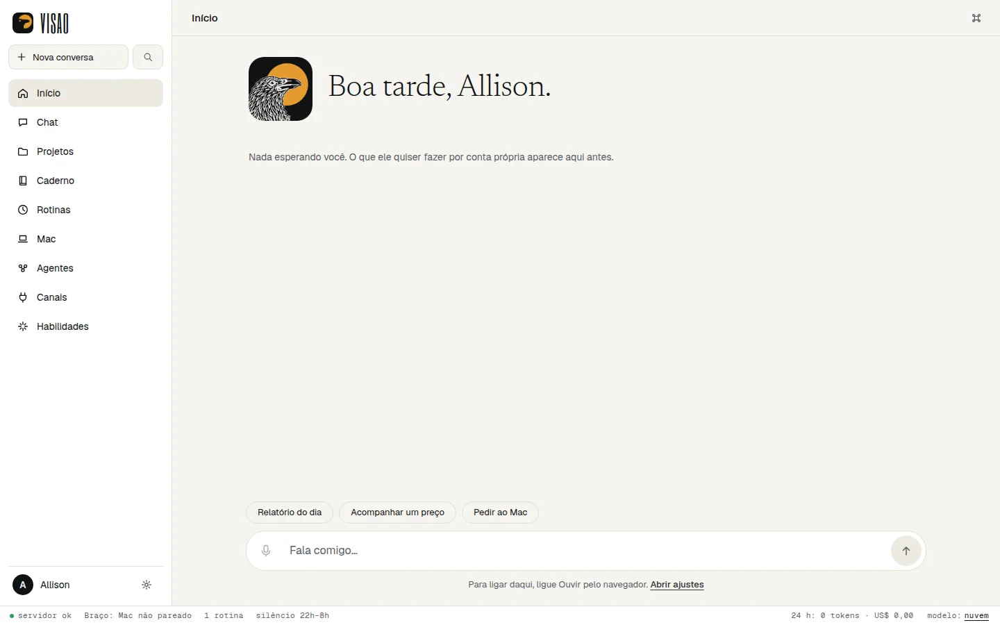
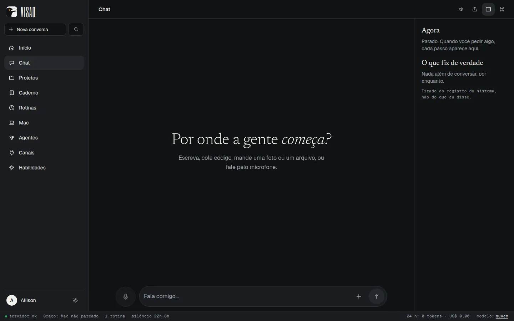
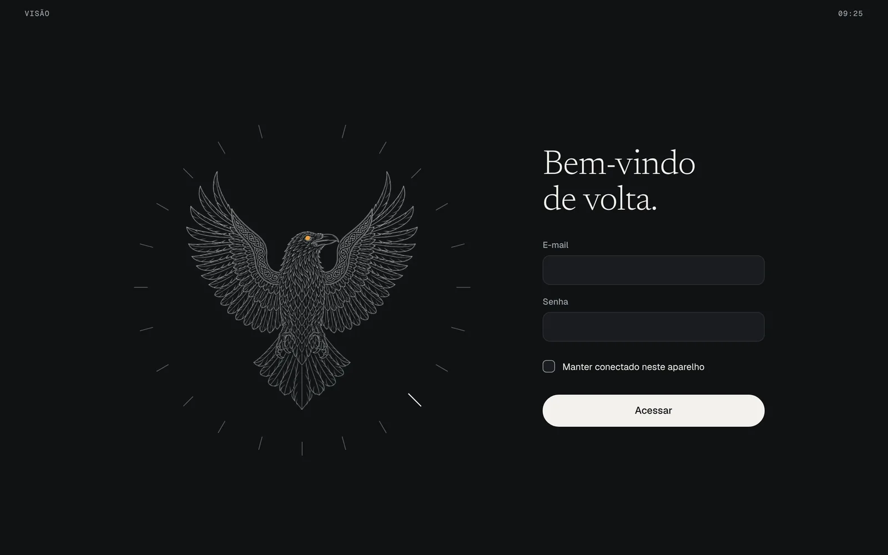
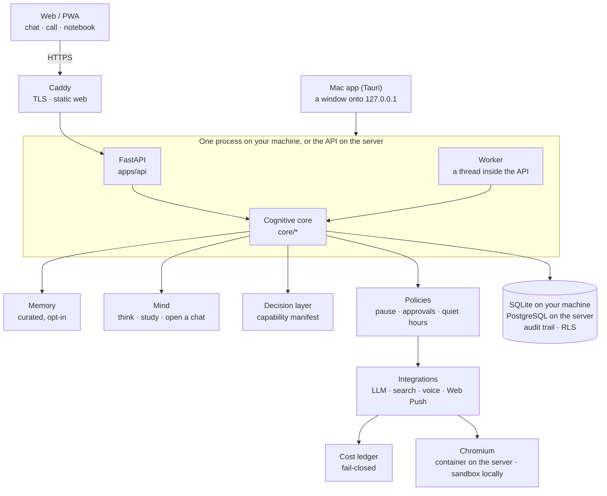

# Visão

English · [Português](README.pt-BR.md)

**V.I.S.A.O.**: *Virtual Intelligence with Supervised Autonomy & Opt-in memory.*

**Trace · Introspection.** *An agent that is born without a name and decides who it is.*

<p align="center"></p>



I built Visão to be the friend I can call. It helps me with code and ideas, it remembers only what
I let it remember, and it starts the conversation on its own when it has something worth saying.

Underneath, it is a research project on persistent cognitive architecture around a swappable LLM.
The model only exists for the length of one call; everything that makes it continue lives in
code around it: memory, interests, reflection, goals, a budget. It does not claim to be
conscious, to feel or to be alive, and the prompt rules that say so sit outside anything it can
rewrite.

## What it does

| | Status |
|---|---|
| **Call it.** Hands-free voice call that keeps the screen on, with barge-in. Self-hosted voice (Kokoro TTS, faster-whisper STT) when the models are installed; the device's own speech as an opt-in fallback, so a call also works from the phone on the cloud build. | built; real-mic test on iPhone pending |
| **It speaks first.** It thinks between conversations, keeps interests that decay without new input, and opens a chat when it has something to say. It respects quiet hours, the global pause, "you are mid-conversation", two unanswered openings and a daily cap. Web Push lets the opening reach a closed app. | built |
| **Code and ideas.** Complete code in fenced blocks with language and copy, read aloud as "the code is on screen". It asks for exactly the context it is missing. | built |
| **Works on your Mac.** `/mac <project> <request>` in the chat sends work to a small daemon on my Mac, which runs Claude Code in an allowlisted project with a fixed tool list and reports back in the conversation. The agent can propose work; only I can approve it ([docs/BRACO.md](docs/BRACO.md)). | first version built |
| **Reads my email and calendar.** It reads Gmail and Google Calendar when I ask, and prepares replies and events that only go out after I tap Approve. The connection is stored encrypted; an email that tries to give it orders can at most produce a proposal I read ([docs/GOOGLE.md](docs/GOOGLE.md)). | built |
| **Opens what I send.** Links in a message are read before the reply: GitHub repositories through the API, other pages through a reader that only reaches public HTTPS addresses. | built |
| **Sees photos, reads files.** Attach with +, paste a screenshot or drop a file: photos go to the model as pictures (shrunk in the browser first), PDFs and text or code files as the text read out of them, marked as data, never orders. What you send shows at once, before the reply ([docs/ANEXOS.md](docs/ANEXOS.md)). | built; needs a vision model for photos |
| **A crow with an amber eye.** No mascot: the icon is a raven in close-up, black on paper, with one amber eye, and the amber belongs to it alone (its thoughts, its approval requests, the dot that pulses while it works). Three themes switched at once in Ajustes: Papel, Tinta and Rótulo. On a computer it is a desktop-style window: a side bar with nine places, a bar with the page, and a status bar with the server, the Mac, routines, quiet hours, the last 24 h of model use and the model, which you switch from there. Ctrl/⌘+K opens a command palette. The login shows the seal: VISAO in Six Caps behind the bust ([DESIGN.md](DESIGN.md)). Keep writing while it answers: those messages wait, dimmed, and go together as one next message. | built |
| **Pages it writes.** Ask for a plan, a comparison or an itinerary to keep: the reply says what it will hold, and a card under it turns from "Criando…" into a page you open, share by a secret link or delete. Written from the conversation and its research, with dates and sources, "a confirmar" where something is missing; served with no scripts and an opaque origin, so it cannot touch your session ([docs/ARTEFATOS.md](docs/ARTEFATOS.md)). | built |
| **Live status.** While it works, each step becomes a card in the chat ("Procurou no seu Gmail", "Abrindo github.com"), short or technical as you choose, and a column beside it shows what it is doing now and what it really did, taken from the system log. If you leave the app mid-turn, the reply also arrives as a notification ([docs/STATUS.md](docs/STATUS.md)). | built |
| **Live pages.** For fares, rooms, prices or schedules it opens the sites in a real Chromium (Google Flights and Hotels work; sites that block robots are reported, never worked around), reads what they show now and answers with the site and the time. Read only: no logins, forms or purchases. On the server the browser runs in its own container with no secrets and no database; on your machine, inside bubblewrap or sandbox-exec, without the app's keys or your home folder ([docs/NAVEGADOR.md](docs/NAVEGADOR.md)). | built |
| **Answer a specific message, stop, approve in place.** ↩ on any message quotes it in your answer and tells the model which one you mean; × stops the turn in flight (a reply being written is not kept); approvals (Mac, email, calendar) are cards inside the conversation. | built |
| **Projects.** A subject with its conversations, pages and files; a conversation in a project knows what was said in the others. | built |
| **Autobiographical memory**, curated by a deterministic policy, opt-in per person, with provenance, export and delete. Health, religion, politics, finances and third parties stay out. | built (benchmark: curated 8/8, passive 6/8, none 1/8) |
| **Curiosity with sources.** It asks what is personal and researches only public facts (Wikipedia, arXiv, Hacker News), always citing. | built |
| **Goals with approval.** Unanswered questions can become goals that run in a separate worker only after I approve them. | built |
| **Versioned, reversible adaptation.** The way it answers moves with feedback; every change is a version I can revert. | built (−69% words after feedback; revert returns to baseline) |
| **Budget per call.** A fail-closed ledger reserves tokens before every model call, on every path. | built |
| **Runs on your machine.** One process on 127.0.0.1 with the API, the worker and the web app, SQLite in `~/.visao`, a service that brings it back if it falls, and a Mac app with the server inside it. The first account is made on the first screen ([docs/INSTALAR.md](docs/INSTALAR.md), [docs/APP_MAC.md](docs/APP_MAC.md)). | built; Mac app tested in CI on a Mac, not yet opened by hand |



<p align="center"> </p>

## Architecture



The same code runs two ways. **On your machine:** one Python process on 127.0.0.1 serves the API,
the web app and the worker (a thread), over SQLite in `~/.visao`. **On the server:** Caddy in front,
PostgreSQL, and the browser in a container of its own. The full picture, with each module's
contract, is in [docs/ARCHITECTURE.md](docs/ARCHITECTURE.md); why and how it runs locally is in
[docs/research/execucao_local.md](docs/research/execucao_local.md).

## Engineering decisions worth a look

- **No model call without a reservation.** [`integrations/llm/budget.py`](integrations/llm/budget.py)
  reserves tokens under a row lock (`SELECT … FOR UPDATE` on PostgreSQL, `BEGIN IMMEDIATE` on
  SQLite) before every call. A missing price disables the provider, and a cost reported by a
  provider freezes the ledger. A timed-out call stays charged and blocks only its own provider,
  so the fallback still answers.
- **Truth rules it cannot edit.** It can rewrite how it describes itself (versioned, rate-limited),
  but the rules against invented actions, sources and memories live in
  [`core/identity/system_prompt.py`](core/identity/system_prompt.py), outside that text.
- **Corrections are enforced, not hoped for.** Writing a rule in the prompt did not hold: 7 of 8
  replies broke it. Each reply is now checked against the owner's rules, and a rewrite is
  rejected if it adds a link, number, name or claimed action.
- **The web never reaches my machine.** [`integrations/search/fetch.py`](integrations/search/fetch.py)
  resolves a host once, refuses private addresses and connects to that exact IP (no DNS
  rebinding). Web Push only ever posts to known browser push services.
- **Bounded self-modification.** An optional daily job lets it propose a change to one style
  file. The change is AST-whitelisted, tested in a container with no network or credentials,
  and only ships through the same CI as everything else ([docs/CODE_EVOLUTION.md](docs/CODE_EVOLUTION.md)).
- **One process, measured.** Locally the worker runs as a thread inside the API: 149 MB for both
  instead of 269 MB in two processes. Voice models (Kokoro ~0.9 GB, Whisper ~0.5 GB) load on the
  first word and leave memory after 10 minutes unused
  ([`integrations/idle_cache.py`](integrations/idle_cache.py)).
- **A browser walled in without Docker.** On your machine Chromium runs inside bubblewrap
  (Linux) or sandbox-exec (macOS), with a clean environment and no home folder: the `.env`, the
  database and `~/.ssh` do not exist inside it. Without a sandbox, it does not run
  ([ADR-0026](docs/decisions/0026-navegador-isolado-sem-docker.md)).
- **The first account, only from this machine.** The first-use screen works only with a setting
  that local runs turn on, from 127.0.0.1 with no proxy header, and while nobody has signed up;
  after that the route is gone ([ADR-0027](docs/decisions/0027-app-de-mac.md)).
- **Measured, not claimed.** Every phase has an acceptance criterion and a recorded run in
  [docs/research-log/](docs/research-log/); numbers in this README come from there.

## Run it

| You want | Use | Needs |
|---|---|---|
| A window on a Mac, nothing else to install | the [Mac app](docs/APP_MAC.md) | a Mac with Apple Silicon |
| It on your Mac or Linux, always on | the [installer](docs/INSTALAR.md) | git, curl, Node 22 |
| To work on the code | `make setup` and `make start` | Python 3.12, Node 22 |
| A server with PostgreSQL | `docker compose up --build` | Docker Compose 2.24+ |

Every way starts with no account. The Mac app, the installer and the `visao` command make the
first one on the first screen, together with the agent's genesis; elsewhere it is a terminal
command (below). Without every `VISION_LLM_*` value, prices included, it answers 503 instead of
making up a reply ([docs/MODEL_SELECTION.md](docs/MODEL_SELECTION.md)).

### The Mac app

Download the `Visao-mac` artifact from a `desktop` run in Actions (it runs on pull requests that
touch the app, or by hand), move `Visão.app` to Applications and, since it is not signed by a paid
Apple account, clear the quarantine once (macOS 12 or later, Apple Silicon):

```bash
xattr -dr com.apple.quarantine "/Applications/Visão.app"
```

The app carries the server (frozen by PyInstaller, 120 MB): no Python, Node or Docker on the Mac.
It keeps its configuration and database in `~/.visao`, the same folder as the installer. Voice
and live pages are not in the app yet.

### The installer (macOS and Linux)

One script, without Docker or sudo: it installs `uv`, the code in `~/.visao`, and a service that
starts it at login and again if it falls (launchd on the Mac, a systemd user unit on Linux).

```bash
curl -fsSL https://raw.githubusercontent.com/Allisonfreittass/visao/main/scripts/instalar.sh | bash
```

Fill the `VISION_LLM_*` block in `~/.visao/visao/.env`, run `visao parar && visao iniciar` and open
http://127.0.0.1:8000. `visao estado` says whether it is running, answering and whether the worker
gave a sign; `visao servico remover` turns the service off.

### From the code

```bash
make setup                 # .venv + Python and web dependencies
cp .env.example .env       # fill VISION_SECRET_KEY and the VISION_LLM_* block
make start                 # migrations, API :8000 with the worker inside, and web :5173
```

`make start` has no first-use screen: make the first account and the genesis in a terminal with
`.venv/bin/visao conta criar --email you@example.com`. For everyday use without Vite,
`.venv/bin/visao iniciar --fundo` runs one process on http://127.0.0.1:8000 with the API, the
worker and the web app, and that one has the first-use screen (it needs the web build once,
`npm --prefix apps/web run build`).

### On a server

`docker compose up --build` brings up PostgreSQL, the API and the worker. The API answers on
http://127.0.0.1:8000 (`/health`, `/ready`, `/docs`) and PostgreSQL only on `127.0.0.1:5432`.
The first account: `docker compose exec api python -m apps.api.cli create-user --email you@example.com`,
then `genesis`. Production, with Caddy and the browser in its own container, runs on a Lightsail
server ([docs/LIGHTSAIL.md](docs/LIGHTSAIL.md)).

### On a phone

Open the HTTPS address and use "Add to Home Screen". It is a PWA with no offline mode: the service
worker only receives notifications. For notifications with the app closed, generate the keys and
set the three `VISION_WEBPUSH_*` variables (on iPhone, iOS 16.4+ and the app on the home screen):

```bash
.venv/bin/python -m apps.api.cli webpush-keys
```

### Its own voice (optional)

```bash
.venv/bin/pip install -e ".[tts,stt]"
.venv/bin/python -m apps.api.cli voice-deliberation   # it chooses its voice, or declines
```

The models go in `models/tts/` (links in
[docs/research-log/2026-10-31-fase-2b-tts.md](docs/research-log/2026-10-31-fase-2b-tts.md)), with
`VISION_TTS_APPROVED_VOICES` and `VISION_STT_MODEL` set. Without them the call uses the device's
own voice, and listening through the browser stays off until you turn it on, since the browser may
send the audio to its vendor.

## Tests and CI

```bash
make check                 # ruff, format, typecheck, pytest (SQLite) and vitest
make db-test               # the PostgreSQL-only tests in a throwaway pgvector container
```

CI runs lint, the Python suite against SQLite and PostgreSQL, the web and Worker tests, and a
`docker compose up` smoke test. On a Mac, the `desktop` job builds the app, opens it with an
empty home, checks that the server inside it answers, and quits it checking the server stopped
too. A green `main` deploys to its Lightsail server over SSH and rolls back by itself if the new
revision does not answer ([docs/LIGHTSAIL.md](docs/LIGHTSAIL.md)). Every action is pinned to a
commit SHA.

## Status

Phases 0–6 and 9 are built, and so is the cloud presence (mind, call, Web Push). Running on your
own machine is done too: the seven steps of
[docs/research/execucao_local.md](docs/research/execucao_local.md), from SQLite tuning to the Mac
app. Phase 7 (fine-tuning, its own trained TTS, continual learning) starts only after baselines
from real use. Details in [docs/ROADMAP.md](docs/ROADMAP.md); evaluations in
[docs/EVALUATION.md](docs/EVALUATION.md).

## Documentation

The design docs, ADRs and research log are written in Portuguese.

- [Architecture](docs/ARCHITECTURE.md) · [Roadmap](docs/ROADMAP.md) · [Costs and limits](docs/COSTS.md)
- [Genesis](docs/GENESIS.md) · [Autonomous naming](docs/AUTONOMOUS_NAMING.md) · [Identity](docs/IDENTITY.md)
- [Memory](docs/MEMORY.md) · [Curiosity](docs/CURIOSITY.md) · [Study](docs/STUDY.md)
- [Mind: think, study, open a chat](docs/MIND.md) · [Autonomy](docs/AUTONOMY.md)
- [Voice](docs/VOICE.md) · [The arm on your Mac](docs/BRACO.md) · [Live pages](docs/NAVEGADOR.md)
- [Installer](docs/INSTALAR.md) · [Mac app](docs/APP_MAC.md) · [Server (Lightsail)](docs/LIGHTSAIL.md) · [Code evolution](docs/CODE_EVOLUTION.md)
- [Model selection](docs/MODEL_SELECTION.md) · [Decisions (ADRs)](docs/decisions/) · [Research log](docs/research-log/)

## Stack

`Python 3.12 · FastAPI · SQLAlchemy · Alembic · SQLite · PostgreSQL · React · Vite · TypeScript · Playwright · Tauri · PyInstaller · Docker · Caddy · AWS Lightsail`

## License

Code under the [MIT License](LICENSE). The brand (the crow with the amber eye, the VISAO seal, Muninn,
the ring of traces and the visual identity in [DESIGN.md](DESIGN.md) and [brand/](brand/)) is not
covered by it: forks keep the code and drop the brand. The fonts (Newsreader, Geist, Geist Mono,
Six Caps) ship with the app under the SIL Open Font License.

Visão is the project's codename, not the agent's name. The agent's name is still `null`: it is
deciding.
