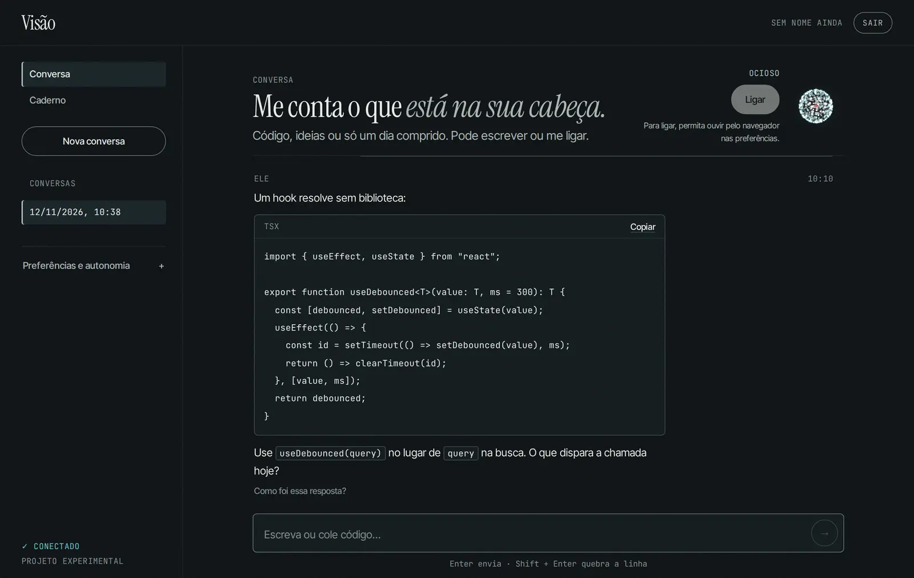
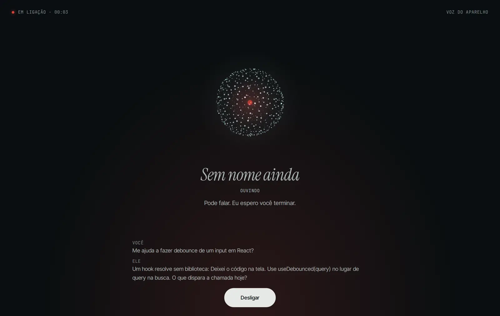
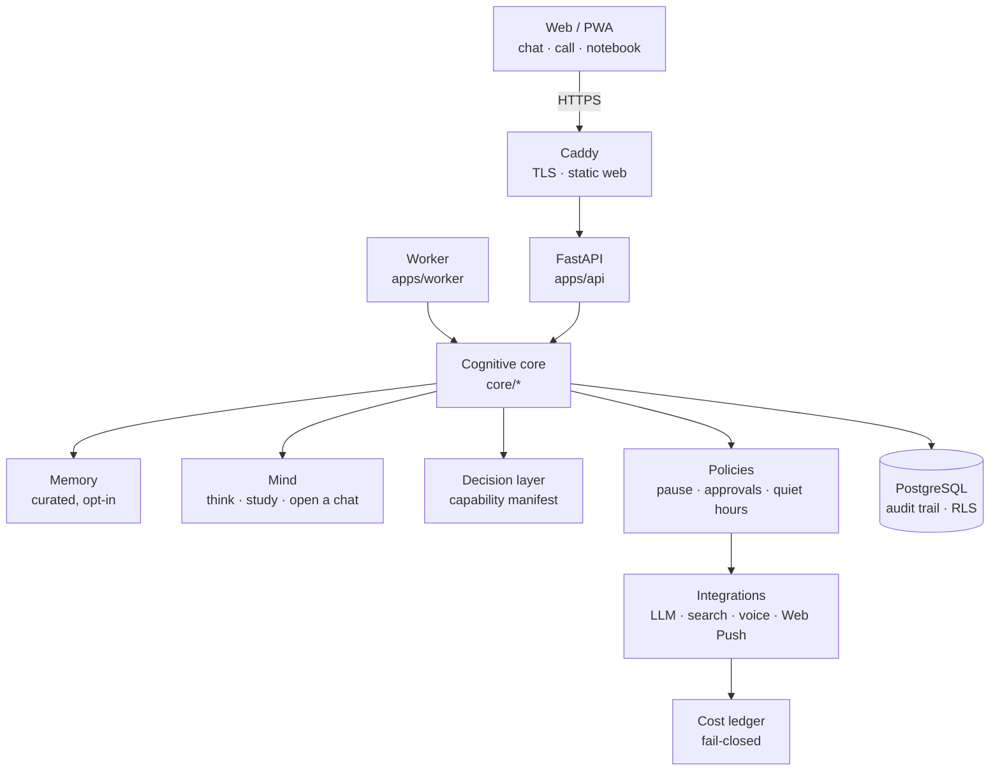

# Visão

English · [Português](README.pt-BR.md)

**Trace · Introspection.** *An agent that is born without a name and decides who it is.*



I built Visão to be the friend I can call. It helps me with code and ideas, it remembers only what
I let it remember, and it starts the conversation on its own when it has something worth saying.

Underneath, it is a research project on persistent cognitive architecture around a swappable LLM.
The model only exists for the length of one call; everything that makes it continue lives in
code around it: memory, interests, reflection, goals, a budget. It does not claim to be
conscious, to feel or to be alive, and the prompt rules that say so sit outside anything it can
rewrite.

## What it does

| | Status |
|---|---|
| **Call it.** Hands-free voice call that keeps the screen on, with barge-in. Self-hosted voice (Kokoro TTS, faster-whisper STT) when the models are installed; the device's own speech as an opt-in fallback, so a call also works from the phone on the cloud build. | built; real-mic test on iPhone pending |
| **It speaks first.** It thinks between conversations, keeps interests that decay without new input, and opens a chat when it has something to say. It respects quiet hours, the global pause, "you are mid-conversation", two unanswered openings and a daily cap. Web Push lets the opening reach a closed app. | built |
| **Code and ideas.** Complete code in fenced blocks with language and copy, read aloud as "the code is on screen". It asks for exactly the context it is missing. | built |
| **Works on your Mac.** `/mac <project> <request>` in the chat sends work to a small daemon on my Mac, which runs Claude Code in an allowlisted project with a fixed tool list and reports back in the conversation. The agent can propose work; only I can approve it ([docs/BRACO.md](docs/BRACO.md)). | first version built |
| **Autobiographical memory**, curated by a deterministic policy, opt-in per person, with provenance, export and delete. Health, religion, politics, finances and third parties stay out. | built (benchmark: curated 8/8, passive 6/8, none 1/8) |
| **Curiosity with sources.** It asks what is personal and researches only public facts (Wikipedia, arXiv, Hacker News), always citing. | built |
| **Goals with approval.** Unanswered questions can become goals that run in a separate worker only after I approve them. | built |
| **Versioned, reversible adaptation.** The way it answers moves with feedback; every change is a version I can revert. | built (−69% words after feedback; revert returns to baseline) |
| **Budget per call.** A fail-closed ledger reserves tokens before every model call, on every path. | built |



## Architecture



The full picture, with each module's contract, is in [docs/ARCHITECTURE.md](docs/ARCHITECTURE.md).

## Engineering decisions worth a look

- **No model call without a reservation.** [`integrations/llm/budget.py`](integrations/llm/budget.py)
  reserves tokens under a row lock (`SELECT … FOR UPDATE` on PostgreSQL, `BEGIN IMMEDIATE` on
  SQLite) before every call. A missing price disables the provider, and a cost reported by a
  provider freezes the ledger. A timed-out call stays charged and blocks only its own provider,
  so the fallback still answers.
- **Truth rules it cannot edit.** It can rewrite how it describes itself (versioned, rate-limited),
  but the rules against invented actions, sources and memories live in
  [`core/identity/system_prompt.py`](core/identity/system_prompt.py), outside that text.
- **Corrections are enforced, not hoped for.** Writing a rule in the prompt did not hold: 7 of 8
  replies broke it. Each reply is now checked against the owner's rules, and a rewrite is
  rejected if it adds a link, number, name or claimed action.
- **The web never reaches my machine.** [`integrations/search/fetch.py`](integrations/search/fetch.py)
  resolves a host once, refuses private addresses and connects to that exact IP (no DNS
  rebinding). Web Push only ever posts to known browser push services.
- **Bounded self-modification.** An optional daily job lets it propose a change to one style
  file. The change is AST-whitelisted, tested in a container with no network or credentials,
  and only ships through the same CI as everything else ([docs/CODE_EVOLUTION.md](docs/CODE_EVOLUTION.md)).
- **Measured, not claimed.** Every phase has an acceptance criterion and a recorded run in
  [docs/research-log/](docs/research-log/); numbers in this README come from there.

## Run it

Requires Python 3.12, Node 22 and, for the Docker path, Docker Compose 2.24+.

```bash
make setup                 # .venv + Python and web dependencies
cp .env.example .env       # fill VISION_SECRET_KEY and the VISION_LLM_* block
make start                 # migrations, API :8000, worker and web :5173
```

Create the first user and run genesis (idempotent):

```bash
.venv/bin/python -m apps.api.cli create-user --email you@example.com
.venv/bin/python -m apps.api.cli genesis
```

Or with Docker (PostgreSQL + API + worker): `docker compose up --build`.

Without every `VISION_LLM_*` value, prices included, the API answers 503 instead of making up a
reply. To let it reach your phone, generate the Web Push keys with
`python -m apps.api.cli webpush-keys` and set the three `VISION_WEBPUSH_*` variables.

## Tests and CI

```bash
make check                 # ruff, format, typecheck, pytest (SQLite) and vitest
make db-test               # the PostgreSQL-only tests in a throwaway pgvector container
```

CI runs lint, the Python suite against SQLite and PostgreSQL, the web and Worker tests, and a
`docker compose up` smoke test. A green `main` deploys to its own Lightsail server over SSH, and rolls back by itself if the new revision does not answer ([docs/LIGHTSAIL.md](docs/LIGHTSAIL.md)). Every action is pinned to
a commit SHA.

## Status

Phases 0–6 and 9 are built, and so is the cloud presence (mind, call, Web Push). Phase 7
(fine-tuning, its own trained TTS, continual learning) starts only after baselines from real use.
Details in [docs/ROADMAP.md](docs/ROADMAP.md); evaluations in [docs/EVALUATION.md](docs/EVALUATION.md).

The design docs, ADRs and research log in [docs/](docs/) are written in Portuguese.

## Stack

`Python 3.12 · FastAPI · SQLAlchemy · Alembic · PostgreSQL · React · Vite · TypeScript · Docker · Caddy · AWS Lightsail`

## License

Code under the [MIT License](LICENSE). The Rastros brand (name, marks and visual identity) is not
covered by it: forks keep the code and drop the brand. Fonts come from Google Fonts under their own
licenses (OFL).

Visão is the project's codename, not the agent's name. The agent's name is still `null`: it is
deciding.
