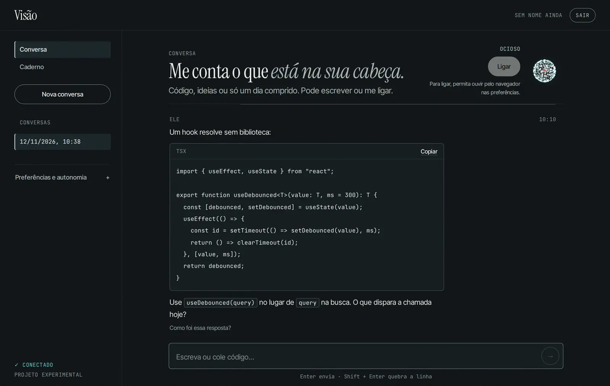
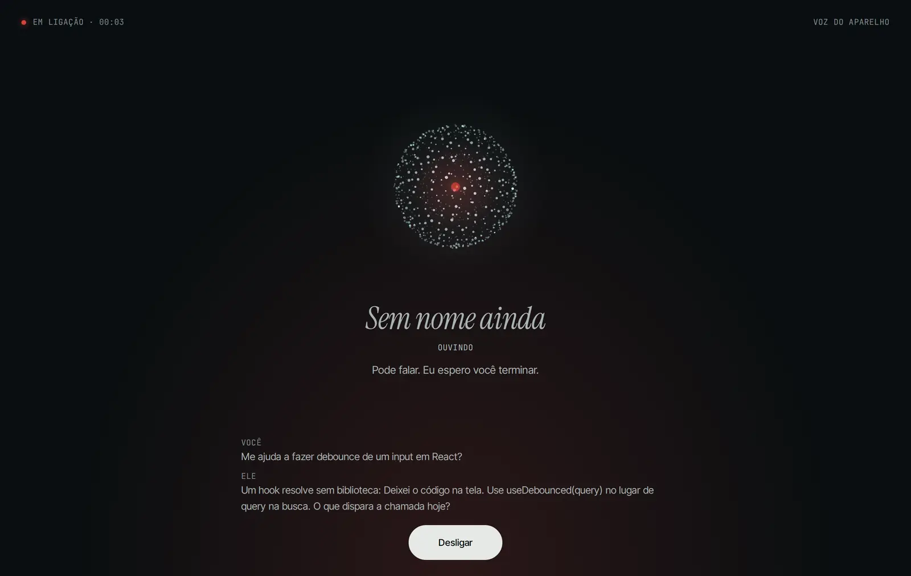
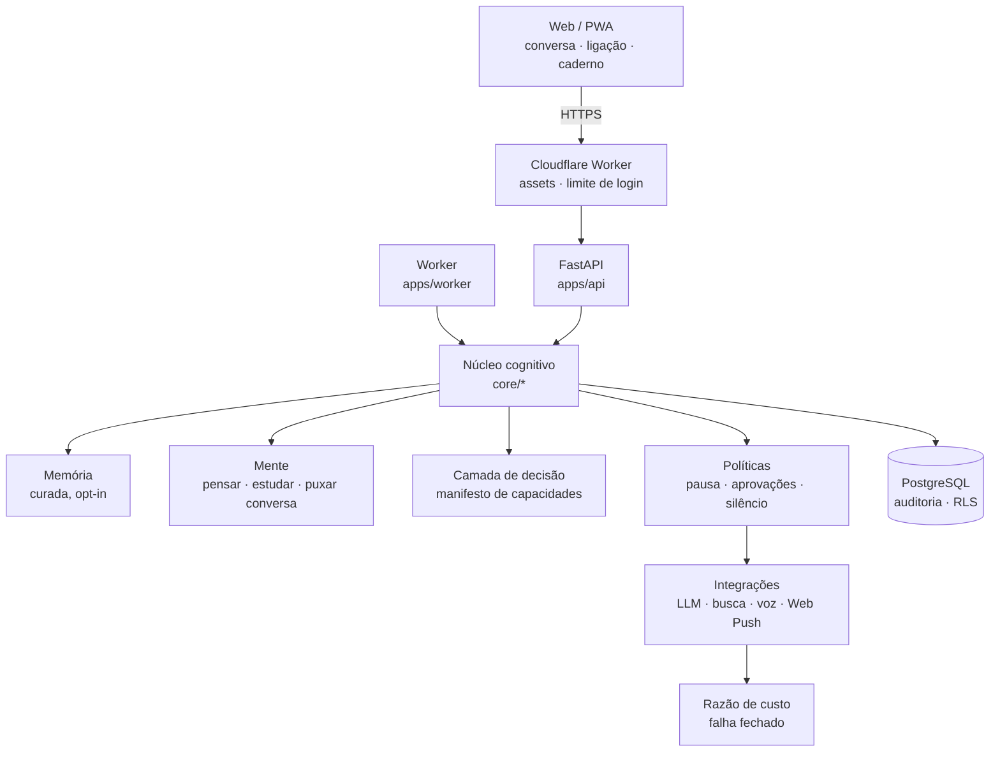

# Visão

[English](README.md) · Português

**Rastro · Introspecção.** *Um agente que nasce sem nome e decide quem é.*



Fiz o Visão para ser o amigo para quem eu ligo. Ele me ajuda com código e ideias, lembra só do
que eu deixo e puxa conversa sozinho quando tem algo que vale dizer.

Por baixo, é uma pesquisa sobre arquitetura cognitiva persistente em torno de um LLM
substituível. O modelo só existe durante uma chamada; o que faz ele continuar mora no código em
volta: memória, interesses, reflexão, metas e orçamento. Ele não alega consciência, sentimentos
nem vida, e as regras que dizem isso ficam fora de tudo o que ele pode reescrever.

## O que ele faz

| | Estado |
|---|---|
| **Ligar.** Ligação por voz sem as mãos, com a tela acesa e interrupção por voz. Voz própria (Kokoro e faster-whisper) quando os modelos estão instalados; a voz do aparelho como reserva opcional, para a ligação funcionar no celular também na versão da nuvem. | feito; falta o teste com microfone real no iPhone |
| **Ele fala primeiro.** Pensa entre as conversas, guarda interesses que enfraquecem sem estímulo novo e abre a conversa quando tem algo a dizer. Respeita o horário de silêncio, a pausa geral, a conversa em andamento, duas aberturas sem resposta e um limite por dia. Com Web Push, o aviso chega com o app fechado. | feito |
| **Código e ideias.** Código completo em blocos com a linguagem e botão de copiar; em voz, diz que o código está na tela. Pede exatamente o contexto que falta. | feito |
| **Memória autobiográfica** curada por uma política determinística, opt-in por pessoa, com proveniência, exportação e exclusão. Saúde, religião, política, finanças e terceiros ficam de fora. | feito (benchmark: curada 8/8, passiva 6/8, sem memória 1/8) |
| **Curiosidade com fontes.** Pergunta o que é pessoal e pesquisa só fatos públicos (Wikipédia, arXiv, Hacker News), sempre citando. | feito |
| **Metas com aprovação.** Perguntas sem resposta viram metas que rodam num worker separado, só depois que eu aprovo. | feito |
| **Adaptação versionada e reversível.** O jeito de responder muda com o retorno; cada mudança é uma versão que dá para desfazer. | feito (−69% de palavras após retorno; desfazer volta à linha de base) |
| **Orçamento por chamada.** Um razão que falha fechado reserva tokens antes de toda chamada ao modelo, em todos os caminhos. | feito |



## Arquitetura



O desenho completo, com o contrato de cada módulo, está em [docs/ARCHITECTURE.md](docs/ARCHITECTURE.md).

## Decisões de engenharia

- **Nenhuma chamada sem reserva.** [`integrations/llm/budget.py`](integrations/llm/budget.py)
  reserva tokens com trava de linha (`SELECT … FOR UPDATE` no PostgreSQL, `BEGIN IMMEDIATE` no
  SQLite) antes de cada chamada. Sem preço, o provedor fica desligado; custo informado pelo
  provedor congela o razão. Uma chamada que estourou o tempo continua cobrada e bloqueia só o
  próprio provedor, então a reserva ainda responde.
- **Regras de verdade que ele não edita.** Ele reescreve como se descreve (versionado, com
  limite), mas as regras contra inventar ações, fontes e lembranças ficam em
  [`core/identity/system_prompt.py`](core/identity/system_prompt.py), fora desse texto.
- **Correção é conferida, não esperada.** Só escrever a regra no prompt não bastou: 7 de 8
  respostas a quebravam. Agora cada resposta passa por uma conferência, e a reescrita é recusada
  se acrescentar link, número, nome ou ação que ele diz ter feito.
- **A web nunca alcança a minha máquina.** [`integrations/search/fetch.py`](integrations/search/fetch.py)
  resolve o endereço uma vez, recusa endereços privados e conecta naquele IP exato (sem DNS
  rebinding). O Web Push só fala com os serviços de push conhecidos dos navegadores.
- **Automodificação com limite.** Um job diário opcional deixa ele propor mudança num único
  arquivo de estilo, com AST em lista branca, testes num container sem rede nem credenciais e o
  mesmo CI de tudo ([docs/CODE_EVOLUTION.md](docs/CODE_EVOLUTION.md)).
- **Medido, não prometido.** Cada fase tem critério de aceite e execução registrada em
  [docs/research-log/](docs/research-log/); os números deste README vêm de lá.

## Como rodar

Requer Python 3.12, Node 22 e, para o caminho com Docker, Docker Compose 2.24+.

```bash
make setup                 # .venv e dependências de Python e do web
cp .env.example .env       # preencha VISION_SECRET_KEY e o bloco VISION_LLM_*
make start                 # migrações, API :8000, worker e web :5173
```

`make start` (ou `npm start`) sobe os três no mesmo terminal, com a saída prefixada por `[api]`,
`[worker]` e `[web]`; Ctrl+C para todos. Com `VISION_DATABASE_URL` apontando para um PostgreSQL
compartilhado, ele não migra: só confere se o banco está na versão do código.

Criar o usuário inicial e executar o genesis (idempotente):

```bash
.venv/bin/python -m apps.api.cli create-user --email voce@exemplo.com
.venv/bin/python -m apps.api.cli genesis
```

Com Docker (PostgreSQL, API e worker): `docker compose up --build`. A API fica em
http://127.0.0.1:8000 (`/health`, `/ready`, `/docs`) e o PostgreSQL só em `127.0.0.1:5432`.

Sem todas as variáveis `VISION_LLM_*`, inclusive os preços, a API responde 503 em vez de inventar
uma resposta.

### No celular

Abra o endereço HTTPS e use "Adicionar à Tela de Início". O app é um PWA sem modo offline: o
service worker só recebe avisos. Para os avisos com o app fechado:

```bash
.venv/bin/python -m apps.api.cli webpush-keys
```

Cole as três linhas `VISION_WEBPUSH_*` no `.env` (ou nos segredos da nuvem) e ligue "Avisos com o
app fechado" nas preferências. No iPhone isso só funciona com o app na tela de início (iOS 16.4+).

### Voz própria (opcional)

```bash
.venv/bin/pip install -e ".[tts,stt]"
```

Baixe os modelos para `models/tts/` (links em
[docs/research-log/2026-10-31-fase-2b-tts.md](docs/research-log/2026-10-31-fase-2b-tts.md)),
defina `VISION_TTS_APPROVED_VOICES` e `VISION_STT_MODEL` e deixe ele escolher a voz:

```bash
.venv/bin/python -m apps.api.cli voice-deliberation
```

Sem esses modelos (como na nuvem), a ligação usa a voz do aparelho. Ouvir pelo navegador fica
desligado até você ligar, porque o navegador pode mandar o áudio ao fabricante dele.

## Testes e CI

```bash
make check                 # ruff, formatação, typecheck, pytest (SQLite) e vitest
make db-test               # testes só de PostgreSQL num pgvector descartável
```

O CI roda lint, a suíte Python contra SQLite e PostgreSQL, os testes do web e do Worker e um
`docker compose up` de fumaça. Uma `main` verde publica no Cloudflare. Toda action está fixada
por SHA.

## Estado

Fases 0–6 e 9 construídas, assim como a presença na nuvem (mente, ligação e Web Push). A Fase 7
(fine-tuning, TTS próprio treinado, aprendizado contínuo) só começa com baselines de uso real.
Detalhes em [docs/ROADMAP.md](docs/ROADMAP.md); avaliações em [docs/EVALUATION.md](docs/EVALUATION.md).

## Documentação

- [Arquitetura](docs/ARCHITECTURE.md) · [Roadmap](docs/ROADMAP.md) · [Custos e limites](docs/COSTS.md)
- [Genesis](docs/GENESIS.md) · [Nome autônomo](docs/AUTONOMOUS_NAMING.md) · [Identidade](docs/IDENTITY.md)
- [Memória](docs/MEMORY.md) · [Curiosidade](docs/CURIOSITY.md) · [Estudo](docs/STUDY.md)
- [Mente: pensar, estudar e puxar conversa](docs/MIND.md) · [Autonomia](docs/AUTONOMY.md)
- [Voz](docs/VOICE.md) · [Nuvem](docs/CLOUDFLARE.md) · [Evolução de código](docs/CODE_EVOLUTION.md)
- [Seleção de modelos](docs/MODEL_SELECTION.md) · [Decisões (ADRs)](docs/decisions/) · [Diário de pesquisa](docs/research-log/)

## Pilha

`Python 3.12 · FastAPI · SQLAlchemy · Alembic · PostgreSQL · React · Vite · TypeScript · Cloudflare Workers + Containers · Docker`

Visão é o codinome do projeto, não o nome do agente. O nome dele continua `null`: ele está
decidindo.
