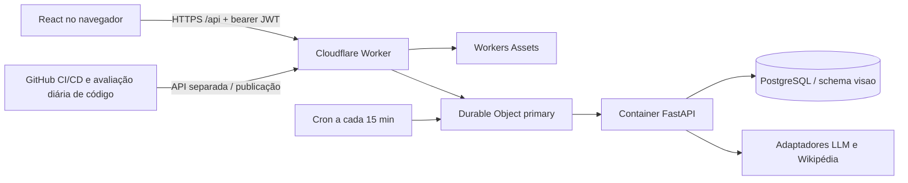

# Fase 10A — Estado atual e auditoria do VISÃO

> Fase 10A · estudo de 31/10/2026 · fuso America/Sao_Paulo. Código auditado: `afc2295b8d631e8cb793100a6a92e216bd89230e`.
> Documento de diagnóstico/proposta. Nenhuma implementação, migração, configuração de produção ou publicação faz parte desta entrega.

## Conclusão executiva

O VISÃO já é um monólito modular com estado persistente, decisões auditáveis e execução autônoma limitada. A prioridade é consolidar continuidade, concorrência, privacidade e orçamento, aproveitando esses mecanismos. Não há fundamento técnico para começar por uma reescrita, um novo serviço de agentes ou uma simulação de emoções.

A premissa Lightsail do texto recebido está desatualizada para a implantação validada nesta conversa: frontend em Workers Assets, gateway Worker, um Durable Object que controla um Container Python `lite`, PostgreSQL no Supabase, schema privado `visao`, e CI/CD no GitHub. Não foi auditada uma instância AWS nem se afirmou que ela deixou de existir. `docs/COSTS.md` ainda contém hipóteses históricas de Lightsail; não é inventário financeiro atual.

## Método e limites de evidência

- **I**: existe implementação; **G**: há chamada em um fluxo efetivo; **T**: foi coberto por testes locais existentes nesta auditoria; **H1**: observação de produção anterior nesta conversa, não reexecutada como experimento novo.
- T usa provedores simulados e banco descartável; não demonstra qualidade geral do LLM, funcionamento em um iPhone ou integração física de áudio.
- Inspeção de `apps`, `core`, `integrations`, `infrastructure`, `migrations`, frontend, workflows, documentação e testes. Buscas negativas foram limitadas a essas árvores; não provam ausência de recursos fora deste repositório.
- Execuções novas: suíte offline existente e quatro microexperimentos locais descritos abaixo. Nenhum sensor ativado, mensagem ao agente, novo serviço, chamada de inferência real ou deploy nesta rodada.
- Uma consulta SQL somente de contagens foi realizada para esclarecer a dúvida do usuário sobre o painel Supabase: `visao` tem 29 tabelas, 1 identidade, 1 usuário, 5 conversas, 66 mensagens, 5 memórias, 2 estudos e 18 jobs; `public` tem zero tabelas. Contagens são uma fotografia, não uma promessa de imutabilidade.

## Arquitetura e entradas reais

1. Texto: `Api.send` → `POST /conversations/{id}/messages` → verificação de proprietário → `run_turn` → curiosidade/contexto/caderno → `reply` → persistência de mensagens, uso e decisão [R06][R07]. É uma resposta HTTP completa, sem streaming de tokens.
2. Autonomia em nuvem: Cron → chamada interna autenticada → `schedule` → fila persistida → até dois jobs por verificação → handlers → `run_cycle`. O ciclo cognitivo é horário; uma verificação pode ficar ociosa [R14][R15][R16][R29]. O daemon `apps/worker/main.py` é a alternativa local; não deve duplicar a execução em nuvem.
3. Estudos: seleção de pergunta → busca pública → revisão vinculada às fontes → registro de achados/limites. Rodada nova após seis horas; uma tentativa inconclusiva elegível admite uma retomada após uma hora. Reutilizar o mecanismo, não criar outro loop [R17].
4. Voz no código: gesto → `getUserMedia` → AudioWorklet/VAD → WAV por enunciado → POST STT → turno textual → TTS por sentenças → playback. No deploy atual, STT e TTS estão desabilitados em configuração [R10][R11][R12][R13][R29].

## Matriz de capacidades

Custos nesta tabela são classes de recurso, não valores medidos: **DB** armazenamento/consultas; **LLM** inferência sujeita ao provedor; **C** tempo de Container/Worker; **0L** processamento local sem serviço contratado novo. Nenhuma classe significa gratuidade ilimitada.

| Recurso / estado | Evidência | Fluxo efetivo | Testes / observação | Limitação | Risco | Custo | Lacuna prioritária |
|---|---|---|---|---|---|---|---|
| Identidade — I/G/T | [R01][R02] | `Conversation.identity_id` referencia identidade global estável, nome separado | `test_identity`, `test_no_imposed_identity` | Invariante de identidade única verificado em código, não um serviço distribuído de identidade | Confundir identidade global com dados pessoais globais | DB | Separar visão operacional global de informações por usuário |
| Nome opcional — I/G/T | `core/identity/name_deliberation.py` | Job de deliberação, eventos, aviso sujeito às políticas | `test_phase9`, inclusive adiar/recusar | Nenhum nome é obrigatório | Confundir escolha linguística com consciência | LLM/DB | Manter histórico, sem forçar nome |
| Login — I/G/T | [R03][R04][R05] | Argon2 + JWT HS256 com sub/iat/exp; usuário ativo verificado | `test_security`, `test_api` | Sem sessão persistida, refresh token ou revogação por dispositivo | Token roubado continua válido até expirar, salvo bloqueio global do usuário/chave | C/DB | Sessão revogável; proteção do armazenamento no cliente |
| Histórico entre clientes — I/G/T; H1 | [R06][R08][R09] | Listagem e leitura por proprietário após login | `test_conversations_api` testa isolamento | Seleção da conversa é estado React; não há handoff causal | Cliente desatualizado pode mostrar histórico antigo | DB/C | Retomada explícita + cursor + sincronização incremental |
| device/session/turn/event — não existentes no domínio de clientes | `models.py`, `MessageIn` | IDs UUID4 de conversa/mensagem; `ResearchSource.session_id` é sessão de pesquisa | Não há teste multiplataforma correspondente | UUID4/timestamp não define ordem causal | POST repetido ou simultâneo pode gerar turnos duplicados | DB/LLM | `client_turn_id`, sequência do servidor, leases de turno |
| Streaming SSE/WS — não existente | `api.ts`, rotas e buscas por protocolos | Fetch HTTP JSON; sem `EventSource`, WebSocket ou event stream | Testes HTTP | Resposta completa; sem replay de eventos | Reconexão exige recarregar; retry de POST é ambíguo | C | Contrato de eventos antes do transporte |
| PWA instalável — não existente no repo | `index.html`, `vite.config.ts` | SPA responsiva com viewport/theme-color | Sem teste de instalação | Sem manifest, service worker ou política de cache offline | Ser adicionado à tela inicial não prova push/sync | 0L/C | PWA mínima sem cache de dados privados |
| Notificações — I/G/T, apenas internas | [R18][R19] | DB + polling; horário silencioso e limite de cinco por 24h | `test_jobs_goals`, `test_initiatives_api` | Sem subscription por dispositivo/categoria, dispatcher push ou recibo do SO | Duplicação sob concorrência; prévia sensível se reaproveitada no push | DB/C | Outbox/Delivery + opt-in + texto genérico |
| STT/TTS — I/G/T com fakes; desligados na nuvem | [R10][R11][R12] | Upload por enunciado; síntese devolve WAV inteiro | `test_voice_api`, testes VAD/fila | Sem áudio duplex em rede; extras/modelos não estão no pequeno deploy | Falhas de permissão, memória e latência | 0L ou C | Medição antes de habilitar; iPhone real |
| Barge-in — I/G/T parcial | `App.tsx`, `speech/speaker.ts`, `voice/vad.ts` | Início da fala corta playback; `busyRef` descarta enunciado durante turno ocupado | Testes de VAD/fila | Não cancela inferência já iniciada nem fornece protocolo de cancelamento | Fala perdida em sobreposição | 0L/C | Cancelamento/fencing e indicadores honestos |
| Encerrar captura — I/G; T parcial | [R10], `App.tsx:endVoiceSession` | `track.stop()` e encerramento ao ocultar página/logout | VAD/WAV não equivalem a testar lifecycle do microfone | Corrida possível entre permissão pendente e atribuição de `micRef` | Captura pode iniciar após evento de ocultação já tratado; hipótese de código, não reprodução em aparelho | 0L | Teste de permissão tardia e sinal de cancelamento |
| Fila — I/G/T parcial | [R14] | Chave única, claim otimista, lease 300s, backoff, dead-letter por `fail` | `test_jobs_goals`; experimentos X1/X2 abaixo | Claim por lease expirado não filtra limite de tentativas; complete não exige fencing | Retries após crashes sem limite efetivo; escritor atrasado sobrescreve estado | DB/C | Orçamento de tentativas no claim e fencing de conclusão |
| Curiosidade — I/G/T | [R22] | Lacuna → policy determinística ASK/RESEARCH/DEFER/IGNORE | `test_curiosity_policy`, `test_phase9` | Escores vêm do LLM; incerteza armazenada não é probabilidade calibrada nem controla sozinha a policy | Perguntas irrelevantes e falsa confiança | LLM/DB | Calibração e avaliações negativas; não duplicar engine |
| Memória — I/G/T | [R20][R21] | Curação consentida, provenance, recuperação lexical + recência/confiança | `test_memory_api`, benchmark local | Não usa embeddings/pgvector no fluxo atual | Memória equivocada; apagamento parcial do conjunto de dados | LLM/DB | Exportação/retenção amplas e avaliação de recuperação |
| Reflexão/comportamento — I/G/T | [R23][R35] | Lições de conversa; feedback repetido muda parâmetros versionados | `test_behavior_api`, `test_behavior`, `test_phase9` | Estado de comunicação por usuário, não sistema afetivo geral | Interpretar ajuste de estilo como emoção | LLM/DB | Ligação de estado funcional a efeitos observáveis |
| Automodelo — fragmentos I/G/T | [R24][R38] | Capabilities calculadas, identidade, nome e histórico alimentam a resposta | `test_phase9` e testes de identidade | Sem SelfModel único versionado que reúna capacidades, erros, hipóteses e resultados | Negação/alegação de capacidade ainda pode sair incorreta do LLM | DB/LLM | Projetar uma visão derivada, não outra identidade |
| Orçamento — I/G/T parcial | [R15][R17][R28] | Pré-checagem de chamadas, tokens, pesquisas e USD | Testes de orçamento nas suítes atuais | Não há allowlist gratuita, reserva financeira atômica ou teto de hospedagem | Fallback pago ou concorrência ultrapassar intenção de zero gasto | LLM/C | BudgetGuard de admissão e evidência de gratuidade |
| Fallback — I/G/T | [R27] | Cota/429/timeout/rede/5xx aciona próximo provedor; quota tem cooldown | `test_llm_fallback`, X3 | Preço/permissão financeira não participa da escolha | Configuração paga pode ser selecionada | LLM | Bloquear endpoint não aprovado antes da requisição |
| Evolução de código — I/G/T; H1:no_change | [R25][R26][R34] | Uma proposta/dia, dois arquivos, teste isolado, commit e CI/CD | `test_evolution`; avaliação real anterior recusou mudança | AST não limita complexidade de execução; autopatch real não foi observado neste experimento inicial | Exaustão de recursos ou regressão não coberta por teste | LLM/C/Actions | X4; limites de execução e provas de rejeição |
| Exclusão/exportação — I/G/T parcial | [R21], `routes/memory.py` | Exporta memórias; remove registro e sanitiza candidato | `test_memory_api` | Não é exportação/apagamento de conta, chats, estudos, lições e backups | Supor exclusão total quando só a memória curada foi apagada | DB | Inventário completo + tombstones + retenção |
| Pause — I/G/T parcial | [R36] | Impede novos jobs/iniciativas; conversa permanece | `test_cloud_tick`, `test_phase9` | Não mata chamada em andamento; rota global não distingue administrador | Um usuário ativo pode alterar autonomia global em cenário multiusuário | DB/C | Pausa por domínio, RBAC e cancelamento limitado |
| Persistência e RLS — I/G/T parcial | [R33], `database/session.py` | Schema privado e backend com login dedicado; JWT próprio, não Supabase Auth | Migração SQLite local; PostgreSQL em CI anterior | Política backend_only não impõe isolamento por usuário ao papel do servidor | Bug de filtro no backend não é corrigido por auth.uid() do Supabase | DB | Rever grants/backups e manter testes por proprietário |
| Observabilidade — I/G/T parcial | [R32], ModelUsage/Decision/AuditLog | Logs JSON, consumo, estados de jobs e heartbeat | Testes de persistência e scheduler | Sem tracing por turno/evento, métricas de hardware e redator universal de logs | Mensagens de exceção/traceback podem conter dados não cobertos pelo filtro de extras | C/DB | Correlação, retenção e redação explícita |
| Deploy — I/G/T; H1 | [R29][R30][R31] | CI → CD do SHA aprovado → release/ready/frontend; rollback de código | Testes do controlador e lifecycle; CD real anterior verde | Rollback não desfaz migração e não mede qualidade cognitiva | Alterar docs na main também dispara pipeline atual | C/Actions | Mudança de filtros de CD só com aprovação |

## Resultados novos, exclusivamente locais

**Suíte:** 383 testes backend passaram; 1 foi pulado porque `VISION_TEST_DATABASE_URL` não foi definido; 25 frontend e 8 Cloudflare passaram. Ambos os typechecks TypeScript passaram. Não foi iniciado PostgreSQL de teste, Docker, daemon ou CI remoto nesta rodada.

| Experimento | Procedimento local | Resultado observado | O que demonstra / não demonstra |
|---|---|---|---|
| X1 — tentativas após crash | Job `max_attempts=1`; três claims separados por expiração de lease, sem chamar fail | Attempts 1, 2 e 3, todos aceitos | Limite não é aplicado nesse caminho de recuperação; não prova incidente em produção |
| X2 — escritor atrasado | Worker A perde lease; B reclama; A chama complete com objeto antigo | Job vira DONE e perde lock de B | Falta fencing na conclusão; não mede frequência real |
| X3 — fallback gratuito/pago | Dois FakeLLMProvider; gratuito falha por timeout; segundo tem preço sintético positivo | Provedor fake-paid selecionado, custo sintético 0.002 USD, zero requisições externas | Policy permite fallback com preço; não houve gasto real |
| X4 — limite de AST | Validar, sem executar, função com seis compreensões aninhadas sobre query | Validador aceitou | Sintaxe permitida não implica limite de CPU/RAM; não executou candidato nem explorou produção |

Procedimentos reproduzíveis e critérios futuros: [plano de avaliação](phase10_evaluation_plan.md). H1 inclui o CD [afc2295](https://github.com/Allisonfreittass/visao/actions/runs/41220299576), uma retomada de estudo com fontes e a avaliação de código `no_change`; são observações pontuais, não uma bateria científica comparativa.

## Gargalos e hipóteses para a próxima aprovação

1. **P0 — consistência e identidade de sessão:** turnos sem idempotência/fencing + sessões não revogáveis impedem prometer handoff seguro. Hipótese: IDs de turno e reserva transacional eliminam duplicações no corpus de falhas.
2. **P0 — zero adicional não comprovado:** polling a cada 15s pode manter o Container acordado apesar do timeout de 2min; a franquia da conta é compartilhada. Hipótese: suspensão em background e consulta incremental reduzem tempo ativo e bytes sem aumentar perdas de eventos. Custo observado ainda precisa ser medido.
3. **P1 — escuta e cancelamento:** o caminho normal fecha tracks, mas lifecycle assíncrono requer prova adicional. Não há ensaio físico iOS nesta entrega.
4. **P1 — estados e automodelo:** preservar Capabilities, Decision, KnowledgeGap, StudyEntry e BehaviorStateVersion; compor uma visão revisável com evidências antes de inventar novos módulos cognitivos.
5. **P1 — segurança de evolução:** o teste em container sem rede protege a execução de teste; não isola a futura função na API de produção. O experimento de edição não deve ganhar novo escopo na Fase 10A.

A arquitetura proposta e as aprovações específicas estão em [plano incremental](phase10_implementation_plan.md). Nenhum achado foi corrigido nesta rodada, conforme solicitado.

## Evidências do repositório

- **R01** — [infrastructure/database/models.py:65](https://github.com/Allisonfreittass/visao/blob/afc2295b8d631e8cb793100a6a92e216bd89230e/infrastructure/database/models.py#L65)
[R01]: https://github.com/Allisonfreittass/visao/blob/afc2295b8d631e8cb793100a6a92e216bd89230e/infrastructure/database/models.py#L65
- **R02** — [core/identity/genesis.py:73](https://github.com/Allisonfreittass/visao/blob/afc2295b8d631e8cb793100a6a92e216bd89230e/core/identity/genesis.py#L73)
[R02]: https://github.com/Allisonfreittass/visao/blob/afc2295b8d631e8cb793100a6a92e216bd89230e/core/identity/genesis.py#L73
- **R03** — [apps/api/routes/auth.py:31](https://github.com/Allisonfreittass/visao/blob/afc2295b8d631e8cb793100a6a92e216bd89230e/apps/api/routes/auth.py#L31)
[R03]: https://github.com/Allisonfreittass/visao/blob/afc2295b8d631e8cb793100a6a92e216bd89230e/apps/api/routes/auth.py#L31
- **R04** — [apps/api/security.py:27](https://github.com/Allisonfreittass/visao/blob/afc2295b8d631e8cb793100a6a92e216bd89230e/apps/api/security.py#L27)
[R04]: https://github.com/Allisonfreittass/visao/blob/afc2295b8d631e8cb793100a6a92e216bd89230e/apps/api/security.py#L27
- **R05** — [apps/api/deps.py:33](https://github.com/Allisonfreittass/visao/blob/afc2295b8d631e8cb793100a6a92e216bd89230e/apps/api/deps.py#L33)
[R05]: https://github.com/Allisonfreittass/visao/blob/afc2295b8d631e8cb793100a6a92e216bd89230e/apps/api/deps.py#L33
- **R06** — [apps/api/routes/conversations.py:321](https://github.com/Allisonfreittass/visao/blob/afc2295b8d631e8cb793100a6a92e216bd89230e/apps/api/routes/conversations.py#L321)
[R06]: https://github.com/Allisonfreittass/visao/blob/afc2295b8d631e8cb793100a6a92e216bd89230e/apps/api/routes/conversations.py#L321
- **R07** — [core/conversation/service.py:97](https://github.com/Allisonfreittass/visao/blob/afc2295b8d631e8cb793100a6a92e216bd89230e/core/conversation/service.py#L97)
[R07]: https://github.com/Allisonfreittass/visao/blob/afc2295b8d631e8cb793100a6a92e216bd89230e/core/conversation/service.py#L97
- **R08** — [apps/web/src/session.ts:4](https://github.com/Allisonfreittass/visao/blob/afc2295b8d631e8cb793100a6a92e216bd89230e/apps/web/src/session.ts#L4)
[R08]: https://github.com/Allisonfreittass/visao/blob/afc2295b8d631e8cb793100a6a92e216bd89230e/apps/web/src/session.ts#L4
- **R09** — [apps/web/src/App.tsx:31](https://github.com/Allisonfreittass/visao/blob/afc2295b8d631e8cb793100a6a92e216bd89230e/apps/web/src/App.tsx#L31)
[R09]: https://github.com/Allisonfreittass/visao/blob/afc2295b8d631e8cb793100a6a92e216bd89230e/apps/web/src/App.tsx#L31
- **R10** — [apps/web/src/voice/microphone.ts:56](https://github.com/Allisonfreittass/visao/blob/afc2295b8d631e8cb793100a6a92e216bd89230e/apps/web/src/voice/microphone.ts#L56)
[R10]: https://github.com/Allisonfreittass/visao/blob/afc2295b8d631e8cb793100a6a92e216bd89230e/apps/web/src/voice/microphone.ts#L56
- **R11** — [apps/api/routes/voice.py:111](https://github.com/Allisonfreittass/visao/blob/afc2295b8d631e8cb793100a6a92e216bd89230e/apps/api/routes/voice.py#L111)
[R11]: https://github.com/Allisonfreittass/visao/blob/afc2295b8d631e8cb793100a6a92e216bd89230e/apps/api/routes/voice.py#L111
- **R12** — [apps/api/routes/voice.py:145](https://github.com/Allisonfreittass/visao/blob/afc2295b8d631e8cb793100a6a92e216bd89230e/apps/api/routes/voice.py#L145)
[R12]: https://github.com/Allisonfreittass/visao/blob/afc2295b8d631e8cb793100a6a92e216bd89230e/apps/api/routes/voice.py#L145
- **R13** — [apps/web/src/speech/queue.ts:1](https://github.com/Allisonfreittass/visao/blob/afc2295b8d631e8cb793100a6a92e216bd89230e/apps/web/src/speech/queue.ts#L1)
[R13]: https://github.com/Allisonfreittass/visao/blob/afc2295b8d631e8cb793100a6a92e216bd89230e/apps/web/src/speech/queue.ts#L1
- **R14** — [infrastructure/jobs/queue.py:60](https://github.com/Allisonfreittass/visao/blob/afc2295b8d631e8cb793100a6a92e216bd89230e/infrastructure/jobs/queue.py#L60)
[R14]: https://github.com/Allisonfreittass/visao/blob/afc2295b8d631e8cb793100a6a92e216bd89230e/infrastructure/jobs/queue.py#L60
- **R15** — [core/autonomy/cycle.py:122](https://github.com/Allisonfreittass/visao/blob/afc2295b8d631e8cb793100a6a92e216bd89230e/core/autonomy/cycle.py#L122)
[R15]: https://github.com/Allisonfreittass/visao/blob/afc2295b8d631e8cb793100a6a92e216bd89230e/core/autonomy/cycle.py#L122
- **R16** — [apps/api/routes/cloud.py:34](https://github.com/Allisonfreittass/visao/blob/afc2295b8d631e8cb793100a6a92e216bd89230e/apps/api/routes/cloud.py#L34)
[R16]: https://github.com/Allisonfreittass/visao/blob/afc2295b8d631e8cb793100a6a92e216bd89230e/apps/api/routes/cloud.py#L34
- **R17** — [core/study/service.py:219](https://github.com/Allisonfreittass/visao/blob/afc2295b8d631e8cb793100a6a92e216bd89230e/core/study/service.py#L219)
[R17]: https://github.com/Allisonfreittass/visao/blob/afc2295b8d631e8cb793100a6a92e216bd89230e/core/study/service.py#L219
- **R18** — [core/initiatives/notify.py:40](https://github.com/Allisonfreittass/visao/blob/afc2295b8d631e8cb793100a6a92e216bd89230e/core/initiatives/notify.py#L40)
[R18]: https://github.com/Allisonfreittass/visao/blob/afc2295b8d631e8cb793100a6a92e216bd89230e/core/initiatives/notify.py#L40
- **R19** — [apps/api/routes/goals.py:214](https://github.com/Allisonfreittass/visao/blob/afc2295b8d631e8cb793100a6a92e216bd89230e/apps/api/routes/goals.py#L214)
[R19]: https://github.com/Allisonfreittass/visao/blob/afc2295b8d631e8cb793100a6a92e216bd89230e/apps/api/routes/goals.py#L214
- **R20** — [core/memory/retrieval.py:37](https://github.com/Allisonfreittass/visao/blob/afc2295b8d631e8cb793100a6a92e216bd89230e/core/memory/retrieval.py#L37)
[R20]: https://github.com/Allisonfreittass/visao/blob/afc2295b8d631e8cb793100a6a92e216bd89230e/core/memory/retrieval.py#L37
- **R21** — [core/memory/store.py:48](https://github.com/Allisonfreittass/visao/blob/afc2295b8d631e8cb793100a6a92e216bd89230e/core/memory/store.py#L48)
[R21]: https://github.com/Allisonfreittass/visao/blob/afc2295b8d631e8cb793100a6a92e216bd89230e/core/memory/store.py#L48
- **R22** — [core/curiosity/engine.py:186](https://github.com/Allisonfreittass/visao/blob/afc2295b8d631e8cb793100a6a92e216bd89230e/core/curiosity/engine.py#L186)
[R22]: https://github.com/Allisonfreittass/visao/blob/afc2295b8d631e8cb793100a6a92e216bd89230e/core/curiosity/engine.py#L186
- **R23** — [core/behavior/state.py:83](https://github.com/Allisonfreittass/visao/blob/afc2295b8d631e8cb793100a6a92e216bd89230e/core/behavior/state.py#L83)
[R23]: https://github.com/Allisonfreittass/visao/blob/afc2295b8d631e8cb793100a6a92e216bd89230e/core/behavior/state.py#L83
- **R24** — [core/identity/capabilities.py:90](https://github.com/Allisonfreittass/visao/blob/afc2295b8d631e8cb793100a6a92e216bd89230e/core/identity/capabilities.py#L90)
[R24]: https://github.com/Allisonfreittass/visao/blob/afc2295b8d631e8cb793100a6a92e216bd89230e/core/identity/capabilities.py#L90
- **R25** — [core/evolution/guard.py:8](https://github.com/Allisonfreittass/visao/blob/afc2295b8d631e8cb793100a6a92e216bd89230e/core/evolution/guard.py#L8)
[R25]: https://github.com/Allisonfreittass/visao/blob/afc2295b8d631e8cb793100a6a92e216bd89230e/core/evolution/guard.py#L8
- **R26** — [core/evolution/service.py:67](https://github.com/Allisonfreittass/visao/blob/afc2295b8d631e8cb793100a6a92e216bd89230e/core/evolution/service.py#L67)
[R26]: https://github.com/Allisonfreittass/visao/blob/afc2295b8d631e8cb793100a6a92e216bd89230e/core/evolution/service.py#L67
- **R27** — [integrations/llm/fallback.py:23](https://github.com/Allisonfreittass/visao/blob/afc2295b8d631e8cb793100a6a92e216bd89230e/integrations/llm/fallback.py#L23)
[R27]: https://github.com/Allisonfreittass/visao/blob/afc2295b8d631e8cb793100a6a92e216bd89230e/integrations/llm/fallback.py#L23
- **R28** — [apps/api/settings.py:12](https://github.com/Allisonfreittass/visao/blob/afc2295b8d631e8cb793100a6a92e216bd89230e/apps/api/settings.py#L12)
[R28]: https://github.com/Allisonfreittass/visao/blob/afc2295b8d631e8cb793100a6a92e216bd89230e/apps/api/settings.py#L12
- **R29** — [infrastructure/cloudflare/wrangler.jsonc:16](https://github.com/Allisonfreittass/visao/blob/afc2295b8d631e8cb793100a6a92e216bd89230e/infrastructure/cloudflare/wrangler.jsonc#L16)
[R29]: https://github.com/Allisonfreittass/visao/blob/afc2295b8d631e8cb793100a6a92e216bd89230e/infrastructure/cloudflare/wrangler.jsonc#L16
- **R30** — [infrastructure/cloudflare/src/index.ts:9](https://github.com/Allisonfreittass/visao/blob/afc2295b8d631e8cb793100a6a92e216bd89230e/infrastructure/cloudflare/src/index.ts#L9)
[R30]: https://github.com/Allisonfreittass/visao/blob/afc2295b8d631e8cb793100a6a92e216bd89230e/infrastructure/cloudflare/src/index.ts#L9
- **R31** — [infrastructure/deployment/release.py:81](https://github.com/Allisonfreittass/visao/blob/afc2295b8d631e8cb793100a6a92e216bd89230e/infrastructure/deployment/release.py#L81)
[R31]: https://github.com/Allisonfreittass/visao/blob/afc2295b8d631e8cb793100a6a92e216bd89230e/infrastructure/deployment/release.py#L81
- **R32** — [infrastructure/observability/logging.py:9](https://github.com/Allisonfreittass/visao/blob/afc2295b8d631e8cb793100a6a92e216bd89230e/infrastructure/observability/logging.py#L9)
[R32]: https://github.com/Allisonfreittass/visao/blob/afc2295b8d631e8cb793100a6a92e216bd89230e/infrastructure/observability/logging.py#L9
- **R33** — [migrations/versions/0011_private_cloud_schema.py:23](https://github.com/Allisonfreittass/visao/blob/afc2295b8d631e8cb793100a6a92e216bd89230e/migrations/versions/0011_private_cloud_schema.py#L23)
[R33]: https://github.com/Allisonfreittass/visao/blob/afc2295b8d631e8cb793100a6a92e216bd89230e/migrations/versions/0011_private_cloud_schema.py#L23
- **R34** — [.github/workflows/evolve.yml:1](https://github.com/Allisonfreittass/visao/blob/afc2295b8d631e8cb793100a6a92e216bd89230e/.github/workflows/evolve.yml#L1)
[R34]: https://github.com/Allisonfreittass/visao/blob/afc2295b8d631e8cb793100a6a92e216bd89230e/.github/workflows/evolve.yml#L1
- **R35** — [core/reflection/reflect.py:147](https://github.com/Allisonfreittass/visao/blob/afc2295b8d631e8cb793100a6a92e216bd89230e/core/reflection/reflect.py#L147)
[R35]: https://github.com/Allisonfreittass/visao/blob/afc2295b8d631e8cb793100a6a92e216bd89230e/core/reflection/reflect.py#L147
- **R36** — [core/policies/autonomy.py:24](https://github.com/Allisonfreittass/visao/blob/afc2295b8d631e8cb793100a6a92e216bd89230e/core/policies/autonomy.py#L24)
[R36]: https://github.com/Allisonfreittass/visao/blob/afc2295b8d631e8cb793100a6a92e216bd89230e/core/policies/autonomy.py#L24
- **R37** — [core/conversation/style.py:4](https://github.com/Allisonfreittass/visao/blob/afc2295b8d631e8cb793100a6a92e216bd89230e/core/conversation/style.py#L4)
[R37]: https://github.com/Allisonfreittass/visao/blob/afc2295b8d631e8cb793100a6a92e216bd89230e/core/conversation/style.py#L4
- **R38** — [core/identity/system_prompt.py:25](https://github.com/Allisonfreittass/visao/blob/afc2295b8d631e8cb793100a6a92e216bd89230e/core/identity/system_prompt.py#L25)
[R38]: https://github.com/Allisonfreittass/visao/blob/afc2295b8d631e8cb793100a6a92e216bd89230e/core/identity/system_prompt.py#L25

## Consolidação local — 01/11/2026

Os seis documentos foram reunidos em `docs/research/` e copiados para o pacote de entrega local. A auditoria original do estado atual foi preservada por conter evidências mais detalhadas; os outros cinco documentos vieram da tarefa em nuvem e passaram por revisão local de conteúdo, referências e escopo. HEAD permanece no SHA auditado. Os resultados de testes continuam sendo os da etapa local de 31/10/2026; não houve nova execução das suítes nem dos experimentos nesta consolidação. Nenhuma implementação, migração, commit, push ou publicação foi realizada.
