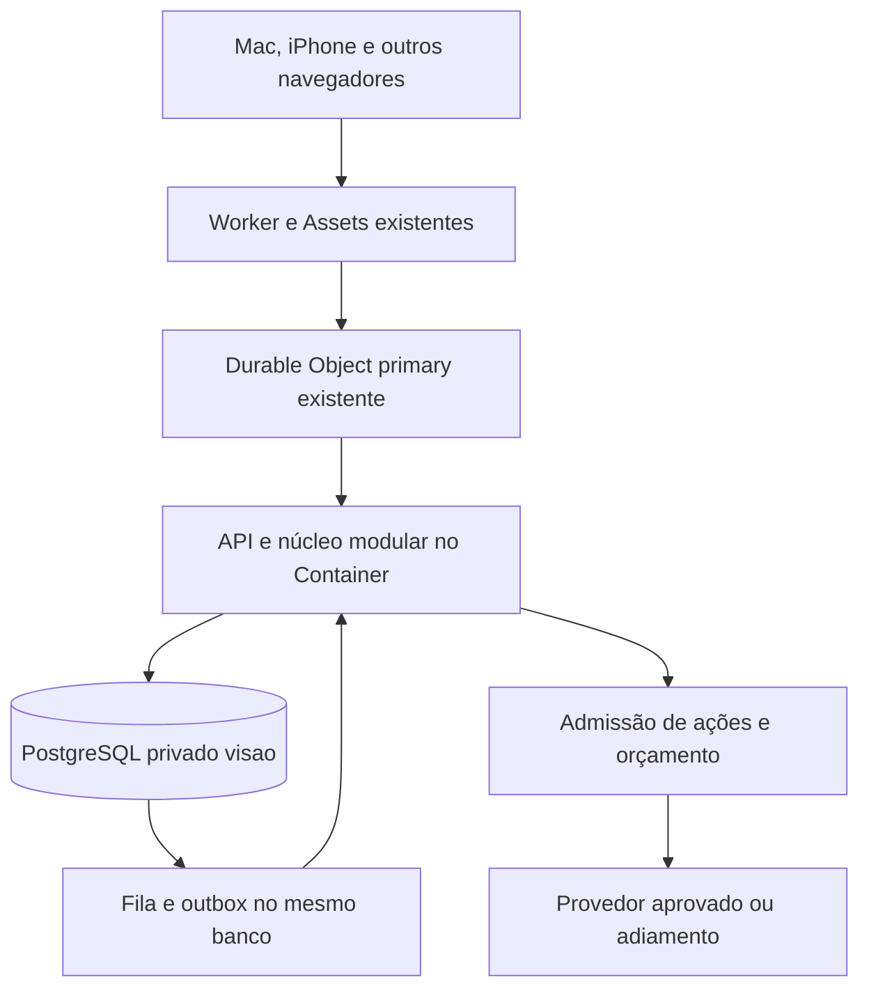

# Fase 10A — Arquitetura de continuidade entre dispositivos

31/10/2026 · America/Sao_Paulo · Proposta não executada. Base: auditoria local fornecida do SHA `afc2295b8d631e8cb793100a6a92e216bd89230e`. Nenhum acesso novo ao repositório privado ou à produção foi feito nesta rodada em nuvem.

## Decisão proposta

Preservar React, Worker, Durable Object primary, Container Python lite, PostgreSQL privado `visao` e mecanismos Fase 9. Acrescentar contratos de sessão, turno, evento e orçamento no monólito. Primeiro REST com cursor e polling adaptativo apenas em primeiro plano; SSE pode ser avaliado depois para sessão ativa. WebSocket somente se medição justificar áudio duplex. Sem Redis, novo servidor, Lightsail, GPU ou provedor pago.

Continuidade significa retomar estado durável autorizado. Fechar o Mac não transmite microfone para o iPhone: o backend existente pode continuar jobs já autorizados, e o iPhone reconstrói contexto após autenticação. A disponibilidade depende dos serviços existentes e das cotas, não da promessa de execução ininterrupta.

O diagrama mistura infraestrutura existente com componentes lógicos propostos, não novos serviços. Outbox, sessões revogáveis e BudgetGuard estrito ainda não existem. A matriz atual está em [auditoria](phase10_current_state.md).

## Identificadores e invariantes

| Identificador | Escopo / geração proposta | Invariante |
| --- | --- | --- |
| agent_id | Identidade estável já existente | Independente do nome e do cliente; não contém memória privada global |
| user_id | Conta autenticada | Proprietário de conversas, memórias, eventos e consentimentos |
| device_id | Aleatório por instalação/perfil, registrado após login | Revogável; sem fingerprint; não é prova de autenticação |
| session_id | Sessão autenticada persistida no servidor | Ligada a usuário/dispositivo; estado ativo/revogado/expirado; diferente de ResearchSource.session_id |
| conversation_id | Conversa do usuário | Acesso verificado em toda leitura/mutação |
| client_turn_id | Aleatório no cliente antes do envio | Chave idempotente única por proprietário/conversa; retry reutiliza o ID |
| turn_id | Registro canônico do servidor | Mesmo client_turn_id + payload igual retorna o mesmo resultado/estado; payload diferente gera conflito |
| event_id | ID opaco único | Não carrega segredo; aponta para evento autorizado |
| sequence | Inteiro monotônico no escopo do stream do usuário | Define ordenação; timestamp/UUID4 não dão causalidade |
| causation_id / correlation_id | Evento pai e cadeia de execução | Liga turno, job, reserva, resultado e entrega |

Guardar tempos do servidor em UTC e exibir no fuso escolhido; timezone não determina ordem causal. Para sequência de commit ordenada, usar contador transacional por stream com lock: uma sequence SQL comum pode ser alocada antes do commit e não garante que a ordem de visibilidade coincida com o número. Não usar relógio do cliente como autoridade.

## Sessão e autenticação

Estudar cookie `HttpOnly; Secure; SameSite` em origem compatível com gateway, acompanhado de proteção CSRF, validação Origin e política CORS restrita. Mutation exige token CSRF vinculado à sessão quando aplicável; SameSite não é a única barreira. GET não produz efeitos. Evitar token em URL, logs ou cache. Expiração curta/renovação e rotação devem ser especificadas e testadas antes de substituir o bearer atual. Não migrar para Supabase Auth por conveniência.

Persistir sessão revogável e checar sua validade em requests e antes de despachar efeitos; JWT atual contém apenas sub/iat/exp e consulta de usuário ativo. Logout revoga a sessão; “sair de todos” revoga conjunto do usuário. Device revogado invalida suas sessões e subscriptions. Uma sessão desconhecida não pode ser inferida como autorizada por reconhecer o device_id. Permissões de SO e permissões do servidor são ambas necessárias, com papéis diferentes.

## Contrato de turno e concorrência

Proposta de API, sem código implementado: `POST /conversations/{id}/turns` recebe client_turn_id, conteúdo e último cursor conhecido; devolve turn_id, status e cursor. Transação curta valida owner, sessão e hash do payload e reserva o turno. Uma execução por conversa: segunda intenção diferente recebe `409 conversation_busy`; o cliente preserva o texto e solicita reenvio explícito após conclusão. Não descartar silenciosamente fala como ocorre no busyRef atual. Retry do mesmo ID retorna estado canônico, sem nova inferência.

Não manter transação SQL aberta durante I/O LLM. Worker recebe lease com geração/fencing token. Complete/fail/renew só atualizam por comparação de ID, estado, geração e dono do lease. Resultado atrasado é rejeitado e auditado. O mesmo princípio corrige X2 na fila. X1 exige verificar max_attempts no claim, inclusive recuperação de lease expirado; job esgotado vai a estado terminal de revisão/dead-letter sem nova chamada.

Cancelamento separa: parar playback local, invalidar interesse no resultado, cancelar transporte quando suportado e cancelar I/O remoto quando o provedor realmente oferece isso. Um abort HTTP não garante cancelamento do processamento nem custo já incorrido. Resultado de geração antiga nunca é anexado ao turno novo.

## Outbox, sincronização e reconexão

Na mesma transação que grava a mudança de domínio, registrar evento com owner, versão de schema, sequence, event_id, tipo, referências mínimas, causation_id e validade. Dispatcher reclama evento com fencing; entregas têm chave única `(event_id, device_id, channel)`. Garantia proposta: efeitos internos idempotentes e entrega pelo menos uma vez com dedup. Não prometer exactly-once para efeitos externos sem cooperação do provedor. Crash após envio e antes de ack deixa resultado ambíguo; registrar `unknown`, evitar retry cego de efeitos de alto impacto.

`GET /events?cursor=...&limit=...` retorna somente stream autorizado e paginação limitada. Cursor opaco validado no servidor, sem uso como credencial. Índice por owner/sequence; reautorizar objetos referenciados. Cliente aplica por ID/versão, persiste cursor apenas após aplicar lote e ignora duplicatas. Cursor expirado recebe resposta explícita de resync; snapshot consistente com watermark evita lacuna entre snapshot e novos eventos. Tombstones propagam exclusão sem recuperar texto apagado.

Polling proposto: buscar ao abrir, foco ou indicação de rede; enquanto houver trabalho visível, 30 s, aumentando para 60/120 s e até 5 min no ócio, com jitter/backoff. Ao ocultar a página, parar; nada de heartbeat para manter Container vivo. Valores são parâmetros de experimento, não metas de latência garantidas. Verificar mounts/timers para não duplicar consultas. Não fazer retry automático de POST com ID novo.

### Transporte

| Opção | Vantagem | Limite / custo | Escolha |
| --- | --- | --- | --- |
| REST + cursor | Aproveita API, desconecta no ócio, replay explícito | Atraso de consulta e número de requests | Padrão inicial |
| SSE em foreground | Eventos unidirecionais, reconexão e Last-Event-ID padronizados [T1] | Conexão pode manter Container ativo; EventSource nativo não recebe header Authorization arbitrário | Avaliar depois de medir, com cookie seguro ou fetch streaming autenticado; nunca token na URL |
| WebSocket | Duplex para áudio e controle | Backpressure, autenticação, replay e lifecycle adicionais | Adiar até necessidade demonstrada |

Transporte não substitui event log, autorização ou dedup. SSE deve fechar por logout/revogação/inatividade. Uma conexão por aba não é identidade do agente.

## Jornada Mac → iPhone

1. Mac autenticado inicia sessão de voz por gesto; servidor associa voice_session_id à sessão/device e conversation_id.
2. Usuário pede pausar/handoff. Cliente para tracks e playback, invalida callbacks pendentes e recebe confirmação de estado do turno. Se estiver offline, mostrar handoff incompleto; não afirmar cancelamento remoto.
3. iPhone autentica e lista conversa, resumo com fontes, tarefas e último turno. Busca snapshot/cursor; não refaz a resposta anterior.
4. Um token lógico de handoff de curta validade, vinculado a usuário/conversa/devices, pode mover a posse da sessão de voz por transação. Nunca transferir credencial de login ou áudio automaticamente.
5. Apenas um dispositivo detém posse de voz; novo microfone exige gesto e permissão local. Posse no servidor não consegue desligar um microfone fisicamente desconectado: por isso cliente encerra captura ao perder visibilidade/rede/lease e não restaura sozinho. Essa propriedade precisa de teste físico.

Contexto compartilhado é texto autorizado, metadados de turno e estado do objetivo. Resumo é derivado e falível: incluir source_message_ids, versão, data, suporte e lacunas; histórico original permanece recuperável conforme retenção. Nunca inferir dados pessoais de outro usuário através do automodelo global.

## PWA, Safari, Mac e aplicativo nativo

| Caminho | Viabilidade e condições | Decisão |
| --- | --- | --- |
| PWA tradicional iPhone | Home Screen web app no iOS/iPadOS 16.4+; gesto de inscrição, permissão, HTTPS, Push/Notifications API e service worker [T2][T3] | PWA mínima depois das correções P0; testar versão real do usuário |
| Web Push declarativo | Apple documenta formato declarativo que dispensa service worker no caminho compatível [T4] | Atualização da pesquisa: não declarar SW obrigatório para toda modalidade atual; detectar suporte e manter fallback tradicional, sem presumir compatibilidade |
| Background web | Push é evento limitado, não processo permanente [T5]; Safari exige notificação visível [T3] | Sem escuta/loop silencioso; sem promessa de execução da página fechada |
| Mac navegador/PWA | Texto e voz explícita em foreground; notificações dependem do navegador/OS e permissão | Base comum, sem instalação de agente |
| Swift/SwiftUI + APNs | Integração mais profunda, manutenção iOS, distribuição e modos de background delimitados [T6] | Adiar. Conta Apple Developer usual custa 99 USD/ano, fora do orçamento [T7] |
| Menu bar/Atalhos | Pode reduzir fricção se houver benefício mensurável; permissões separadas de microfone/arquivos/acessibilidade | Fora do default; novo estudo e autorização |

Manifest, ícones, display e service worker tradicional são propostos; não existem no SHA auditado. Cache somente shell estático versionado; `no-store` para API privada e logout limpa material sensível do cliente. Sem cache offline de chats por padrão. Voice API deve detectar suporte a AudioWorklet/getUserMedia; indisponibilidade oferece texto, sem pedir permissões repetidamente. Nativo não é solução automática para escuta irrestrita em background. Nenhum recurso de câmera/localização é necessário para essa jornada.

## Voz: contrato e qualidade

O código atual faz VAD local, WAV por enunciado, POST STT, turno textual e TTS WAV por sentença com autoplay; não é streaming duplex. STT/TTS estão desligados nesse deploy. Não habilitar nem escolher modelos pesados para 256 MiB sem medição.

Envelope proposto: versão, event_id, sequence, owner, session_id autenticado, voice_session_id, device_id, conversation_id, client_turn_id quando houver, correlation_id, tempo do servidor e payload mínimo. Eventos de cliente são entrada não confiável, nunca confirmação automática do servidor.

| Evento | Regra |
| --- | --- |
| session.started | Intenção explícita; não significa permissão nem captura |
| permission.granted | Permissão local observada; revalidar geração de sessão antes de usar stream |
| utterance.started / ended | VAD com limites de duração/bytes; não persistir áudio ambiental |
| transcript.final | Texto final associado ao enunciado; revisão de erro antes de efeito externo |
| turn.accepted | Reserva/idempotência confirmadas no servidor |
| response.completed | Resultado da geração válida; não implica áudio tocado |
| playback.started / cancelled | Observação local, correlacionada à resposta; interrupção não cancela LLM por si |
| session.ended | Razão e geração invalidadas; parar tracks e descartar resultado tardio de permission/start |

Invariante para corrida de permissão tardia: marcar cancelamento antes de await; depois da resolução, se sessão não é a mesma geração ativa, parar imediatamente todos os tracks e não registrar stream ativo. Testar ocultação/logout enquanto a permissão está pendente. A hipótese vem de App.startVoiceSession; não foi reproduzida em iPhone. Reconectar nunca reabre microfone.

Medir fim do enunciado → transcript.final → turn.accepted → response.completed → primeira fala audível, com relógio monotônico local e correlação no servidor. Separar latência STT/LLM/TTS/rede, WER, falso fim de turno e interrupção bem-sucedida. Limiares e protocolos estão no [plano de avaliação](phase10_evaluation_plan.md). Preferir transcrição; retenção de áudio zero, dumps desabilitados.

## Notificações autorizadas

Reutilizar iniciativas/notificações internas e limite atual de cinco por 24h. Nova policy determinística exige consentimento ativo por device/categoria, relevância vinculada a objetivo, horário de silêncio em timezone IANA, quota global do usuário e dedup por evento/device. Não multiplicar a quota por quantidade de aparelhos. Proposta conservadora: até duas notificações externas por dia por usuário no piloto, contadas dentro do teto atual; categorias desativadas inicialmente.

Dispatcher guarda tentativa, motivo, versão da permissão, expiração, status aceito/erro/desconhecido. Revalida consentimento imediatamente antes do envio; invalida subscription expirada ou 404/410. Aceitação do push service não prova chegada, leitura ou entendimento. Prévia genérica (“Uma investigação autorizada foi atualizada”); link abre objeto com nova autenticação e owner check. Não colocar conteúdo sensível ou token na URL. Revogar não retira notificação já entregue ao SO; esclarecer essa limitação. Nunca usar ausência de resposta como consentimento nem gerar alertas só para parecer espontâneo.

## Fontes técnicas verificadas em 31/10/2026

- [T1] [WHATWG — Server-sent events](https://html.spec.whatwg.org/multipage/server-sent-events.html), Living Standard consultado.
- [T2] [WebKit — Web Push for Web Apps on iOS and iPadOS](https://webkit.org/blog/13878/).
- [T3] [Apple — Sending web push notifications](https://developer.apple.com/documentation/usernotifications/sending-web-push-notifications-in-web-apps-and-browsers), texto obtido na pesquisa.
- [T4] [Apple WWDC25 — Learn more about Declarative Web Push](https://developer.apple.com/videos/play/wwdc2025/235/), transcrição consultada. Compatibilidade física não testada.
- [T5] [W3C Push API](https://www.w3.org/TR/push-api/), Working Draft de 05/10/2026; não tratar draft como garantia universal de implementação.
- [T6] [Apple — Configuring background execution modes](https://developer.apple.com/documentation/xcode/configuring-background-execution-modes). Página JS; transporte Markdown falhou nesta rodada; limites gerais apoiados na pesquisa fornecida, sem afirmar revisão integral nova.
- [T7] [Apple Developer enrollment](https://developer.apple.com/help/account/membership/program-enrollment/).

[T1]: https://html.spec.whatwg.org/multipage/server-sent-events.html
[T2]: https://webkit.org/blog/13878/
[T3]: https://developer.apple.com/documentation/usernotifications/sending-web-push-notifications-in-web-apps-and-browsers
[T4]: https://developer.apple.com/videos/play/wwdc2025/235/
[T5]: https://www.w3.org/TR/push-api/
[T6]: https://developer.apple.com/documentation/xcode/configuring-background-execution-modes
[T7]: https://developer.apple.com/help/account/membership/program-enrollment/

## Consolidação local — 01/11/2026

Os seis documentos foram reunidos em `docs/research/` e copiados para o pacote de entrega local. A auditoria original do estado atual foi preservada por conter evidências mais detalhadas; os outros cinco documentos vieram da tarefa em nuvem e passaram por revisão local de conteúdo, referências e escopo. HEAD permanece no SHA auditado. Os resultados de testes continuam sendo os da etapa local de 31/10/2026; não houve nova execução das suítes nem dos experimentos nesta consolidação. Nenhuma implementação, migração, commit, push ou publicação foi realizada.
